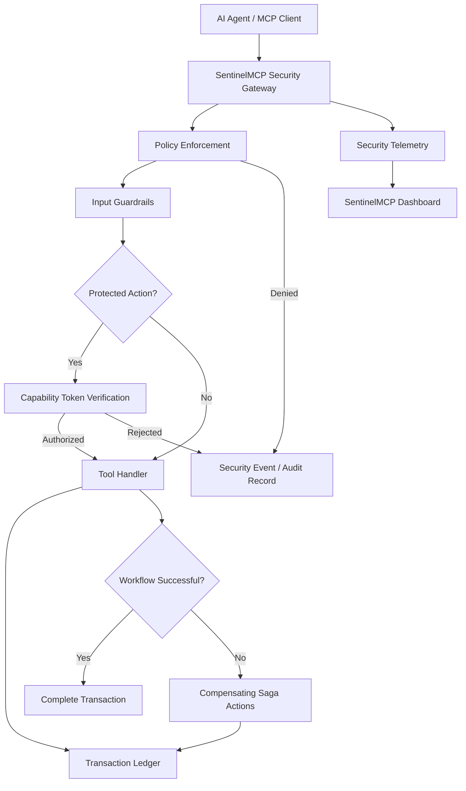

# SentinelMCP — Zero-Trust Security for AI Agents

**SentinelMCP is a security gateway for AI agents using the Model Context Protocol (MCP).** It introduces a policy-enforcement layer between an AI agent and the tools it can invoke, helping control sensitive actions, inspect untrusted inputs, record security decisions, and recover from supported multi-step workflow failures.

As AI agents gain access to APIs, databases, and external tools, applications need more than the ability to execute tool calls. They need authorization, input validation, auditability, and a way to investigate and recover from failures.

SentinelMCP brings these security concerns into one system, combining policy enforcement, capability-based authorization, transaction tracking, security telemetry, and a dashboard for monitoring and investigation.

**Live Dashboard:** https://sentinel-mcp-chi.vercel.app/

**GitHub Repository:** https://github.com/sumadd124/SentinelMCP

## The Problem

AI agents can interact with tools that retrieve information, access resources, or modify data. Without a dedicated security layer, developers face several challenges:

- **Unauthorized tool execution:** An agent may attempt an operation that should require additional permission.
- **Prompt injection:** Untrusted input may attempt to manipulate an agent or influence downstream tool execution.
- **Weak authorization boundaries:** Sensitive operations need permissions scoped to specific actions and contexts.
- **Token replay:** Previously issued authorization should not be reusable when it has expired or already been consumed.
- **Limited auditability:** Security decisions and tool outcomes need to be recorded for investigation.
- **Partial workflow failures:** A failure in a later step of a multi-step operation may require compensating actions for earlier changes.

SentinelMCP addresses these challenges by placing security checks between an agent's tool request and the tool handler.

## The Solution

SentinelMCP acts as a security gateway for MCP-based tool execution. It evaluates requests before they reach protected operations, applies authorization checks where required, records transaction outcomes, and exposes security telemetry for inspection.

Its core design combines:

- Policy-based tool access control
- Input guardrails for suspicious or prompt-injection-related patterns
- HMAC-SHA256-signed capability tokens for selected sensitive actions
- Token expiry, scope validation, and nonce tracking
- SQLite-backed transaction and audit records
- Compensating Saga actions for supported multi-step workflows
- Security event monitoring and incident investigation through a web dashboard
- An optional AWS Bedrock Guardrails integration when configured

The goal is to make agent tool execution more controlled, observable, and auditable.

## How SentinelMCP Works

1. **Request interception:** An MCP tool request enters the SentinelMCP gateway.
2. **Policy evaluation:** The gateway evaluates the request against applicable security rules.
3. **Input screening:** Configured guardrails inspect untrusted input for suspicious patterns.
4. **Capability authorization:** Selected sensitive actions require a valid signed capability token with appropriate scope and expiry.
5. **Controlled execution:** Approved requests are passed to the relevant tool handler.
6. **Transaction recording:** Decisions, execution outcomes, and supported recovery actions are recorded.
7. **Failure compensation:** When a supported multi-step workflow fails, registered compensating actions can run to address earlier changes.
8. **Security monitoring:** The dashboard presents security events and investigation views when the gateway is running and connected.

## Architecture



## Key Features

### 1. Policy Enforcement and Input Guardrails

SentinelMCP evaluates tool requests before execution and can reject requests that violate configured security rules.

Input guardrails are designed to identify suspicious input patterns, including prompt-injection-related attempts. Detection depends on the configured rules and guardrail implementation; no single mechanism can guarantee detection of every attack.

### 2. Capability-Based Authorization

Selected sensitive operations can require signed capability tokens rather than relying solely on the agent's intent.

The authorization design includes:

- HMAC-SHA256 token signing and verification
- Action and scope validation
- Expiry and time-to-live checks
- Nonce tracking intended to prevent token reuse
- Rejection of invalid or unauthorized requests

This provides a foundation for scoped authorization and controlled access to sensitive tools.

### 3. Transaction Ledger and Auditability

SentinelMCP records transaction information in SQLite, helping make tool activity and security decisions easier to inspect.

The ledger supports investigation of execution outcomes and supported recovery operations. Its purpose is to improve traceability when analyzing allowed requests, rejected requests, and workflow failures.

### 4. Compensating Saga Rollbacks

Multi-step agent workflows can fail after some operations have already succeeded.

SentinelMCP supports registered compensating actions for applicable workflows. When a later step fails, these actions can run in reverse order to address earlier changes.

Compensation depends on the handlers implemented for each operation; not every external side effect can be guaranteed to be reversible.

### 5. Security Telemetry and Monitoring

SentinelMCP provides telemetry intended to make gateway activity visible through a web dashboard.

The dashboard brings security-related views together, including:

- Security Stream
- Capability Token Studio
- Attack Lab and Simulations
- Persisted Security Ledger
- Risk Intelligence Matrix
- Forensics and Incident Timeline
- Security Analytics and Metrics

These views support the inspection of security decisions, authorization behavior, and transaction history. Live data depends on the gateway and its telemetry connection being active.

### 6. Optional AWS Bedrock Guardrails Integration

The project includes an optional AWS Bedrock Guardrails integration path alongside a local guardrail approach.

The AWS integration should be considered active only when the required configuration and credentials are supplied and the integration is successfully exercised. The local fallback should not be represented as an AWS service call.

## Technology Stack

The project uses a TypeScript and Node.js-oriented architecture.

| Component | Technology or purpose |
|---|---|
| Core language | TypeScript |
| Runtime | Node.js |
| Agent-tool protocol | Model Context Protocol (MCP) |
| MCP tooling | Official MCP SDK |
| Server framework | Fastify |
| Input validation | Zod |
| Transaction persistence | SQLite / libSQL client |
| Capability signing | HMAC-SHA256 |
| Web dashboard | Next.js |
| Optional cloud guardrails | AWS Bedrock Guardrails |
| Deployment | Vercel for the hosted dashboard |

Refer to the source code and environment configuration for the exact runtime requirements and enabled integrations.

## Running Locally

### Prerequisites

- Node.js 20 or later
- npm
- Git

### 1. Clone the repository

```bash
git clone https://github.com/sumadd124/SentinelMCP.git
cd SentinelMCP
```

### 2. Install dependencies

```bash
npm install
```

### 3. Configure environment variables

Copy the example environment file.

**Windows PowerShell:**

```powershell
Copy-Item .env.example .env
```

**macOS / Linux:**

```bash
cp .env.example .env
```

Review `.env.example` and configure the required values for your environment. Keep API keys, signing secrets, and cloud credentials private. Do not commit secrets to GitHub.

### 4. Start the application

Check the scripts available in the root `package.json` and use the appropriate command to start the gateway and dashboard.

The dashboard is also available at:

https://sentinel-mcp-chi.vercel.app/

A deployed dashboard does not automatically mean that a local or remote MCP gateway is running. Start the gateway separately and verify the connection before testing live telemetry.

### 5. Run tests

```bash
npm test
```

Use the scripts defined in the current `package.json` for any additional type checks, builds, or integration tests.

## Testing and Validation

SentinelMCP's test coverage is intended to exercise security-critical behavior, including:

- Capability token validation
- Policy and guardrail decisions
- Transaction handling and compensation
- MCP integration behavior

Run the test suite against the exact commit you intend to submit. Report test counts only after confirming the current results.

MCP specification-version compliance and transport support should also be verified with a real MCP client before being claimed as complete.

## Hackathon Track Alignment

### Primary Track Candidate: Alexa+

SentinelMCP is a strong conceptual fit for the Alexa+ track because it focuses on securing agent tool execution through the Model Context Protocol.

Its contribution is a security boundary around tool access: policy enforcement, scoped authorization, input guardrails, transaction records, and recovery workflows.

**Eligibility must be verified against the official hackathon requirements.** Confirm that the submitted server supports the required MCP specification version and Streamable HTTP transport, or demonstrate the permitted simulated-client approach. The dashboard alone is not evidence of MCP protocol compliance.

### AWS Builder Mini Challenge — Conditional

The project may fit the AWS Builder mini challenge if an eligible AWS service is genuinely integrated and used in the submitted version.

If using AWS Bedrock Guardrails, document the actual integration, explain how its output influences the security decision, and demonstrate the working path. Do not claim AWS usage merely because the code contains an optional integration.

### Open Source Mini Challenge — Conditional

A public repository alone does not establish eligibility for the Open Source mini challenge. The challenge requires a qualifying new open-source project or contribution during the hackathon window.

If entering this mini challenge, include the qualifying contribution or project URL, repository URL, required GitHub username, and a concise explanation of what changed, how it works, and why it matters.

## Responsible Use and Limitations

- SentinelMCP is a security prototype, not a guarantee of complete protection against malicious inputs.
- Pattern-based guardrails may miss novel attacks or flag legitimate requests.
- Token security depends on secret management, correct verification, and safe nonce handling.
- Compensating actions depend on correctly implemented handlers and cannot reverse every possible external side effect.
- Use sandbox tools and synthetic data when demonstrating attacks and rollback behavior.
- Verify that the gateway is running and connected before describing dashboard data as live.
- Do not expose credentials, private tokens, or sensitive user data in the repository or demonstration.

## Future Improvements

Potential next steps include:

- Broader MCP client and transport interoperability testing
- More comprehensive policy configuration and evaluation
- Stronger observability and structured security reporting
- Expanded integration and adversarial testing
- Improved deployment guidance and secure configuration management
- Additional recovery handlers for supported tool workflows

## Contributing

Contributions that improve security, reliability, documentation, and interoperability are welcome. Please avoid including secrets, live tokens, private user data, or exploit details affecting systems outside this project.

## License

Refer to the repository's `LICENSE` file for the project's current licensing terms. Ensure a suitable open-source license is present and visible in the public repository if required for the intended distribution or hackathon challenge.
